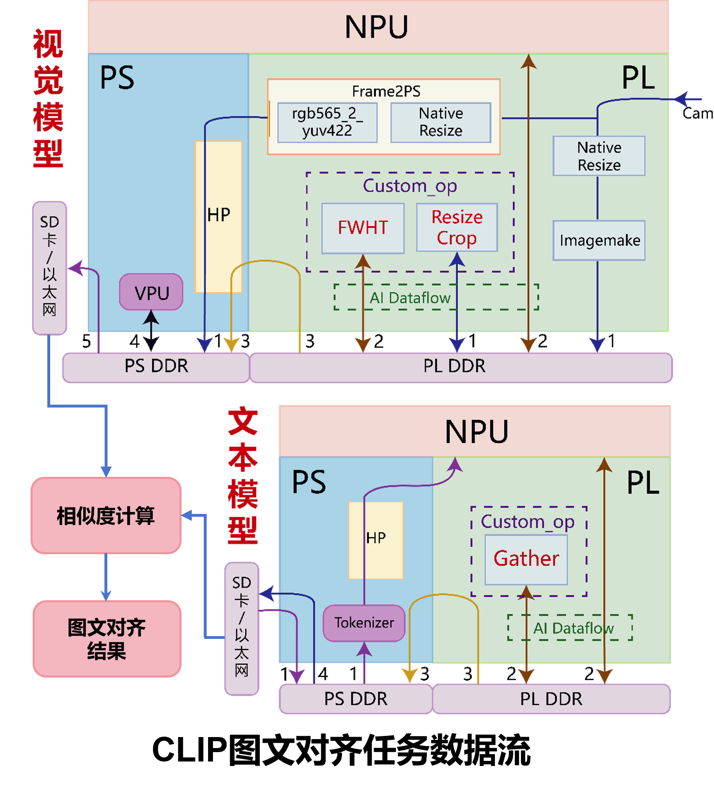
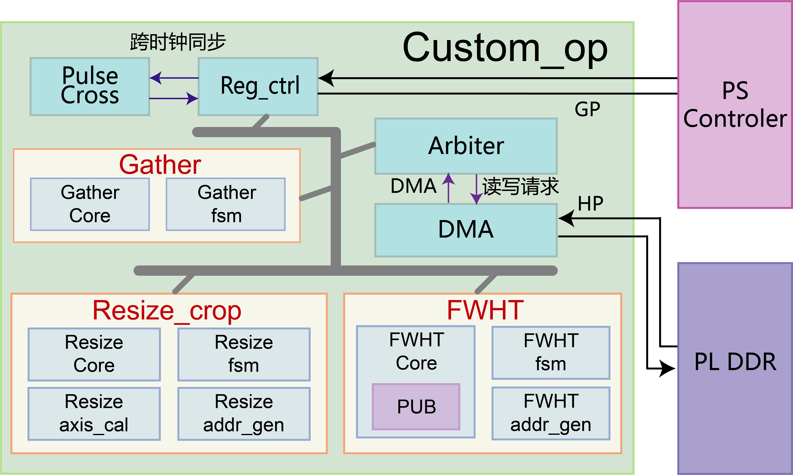

# CLIP ViT-B/32 FPGA 加速项目

> 项目结构与操作指引见 [STRUCTURE.md](./STRUCTURE.md)。
> 环境搭建（硬件/SDK/Docker/编译链）见 [SETUP.md](./SETUP.md)。
> 本文档讲解技术栈实现：RTL 硬算子设计、量化协同、异构加速方案与实测性能。

---

## 1. 系统架构：NPU + FPGA 异构协同

CLIP 视觉编码器在板端拆分为**三段切分链路**，计算任务按特性分配到 NPU 与自研 FPGA 硬算子；文本编码器同样采用"NPU 推理 + 硬算子"组合。两条链路最终汇入**相似度计算**完成图文匹配：

```
【图像链路】(视觉编码器, 三段切分)
              ┌────────── NPU (ZG330) ──────────┐
 图像 → resize →│ seg_pre: patch嵌入+12层编码 → [残差, LN1]│
   (FPGA硬算子) └──────────────┬───────────────┘
                              │ LN1 (50×768 FP32)
                              ▼
                   ┌──────────────────────┐
                   │ FWHT 硬算子 (自研RTL)  │  ← Hadamard 旋转, 量化域计算
                   │ 6级蝶形网络, FP16      │     ~325μs @200MHz
                   └──────────┬───────────┘
                              │ rot (50×768)
                              ▼
              ┌────────── NPU (ZG330) ──────────┐
              │ seg_post: 12层编码+投影 → emb(512)│
              └───────────────┬─────────────────┘
                              │ 图像特征 emb (512-dim, l2norm)
                              ▼
                   ┌──────────────────────┐
                   │ 相似度计算 (CPU)       │  ← cosine(emb, text_feats)
                   │ Top-K → HDMI / Web UI │     阈值判定/排序
                   └───────────┬──────────┘
                               ▲
                              │ 文本特征 text_feat (512-dim, l2norm)

【文本链路】(文本编码器)
 文本 (自然语言)
   │ BPE 分词 (CPU, simple_tokenizer)
   ▼
 token_emb + pos_emb 查表 （49408×512 / 77×512)
   │ mid_in (77×512 FP32)
   ▼
 ┌────────── NPU (ZG330) ──────────┐
 │ text 中间段: 12层编码 → 77×512 特征│
 └──────────────┬─────────────────┘
                │ 77×512 特征 (PL-DDR)
                ▼
 ┌──────────────────────┐
 │ Gather 硬算子 (自研RTL)│  ← 按索引取 EOT 行
 │ 索引聚集, 512 Word     │     文本特征 77 行 → eot_feat (512)
 └──────────┬───────────┘
            │ eot_feat (512)
            ▼
 text_proj 投影 (CPU, 512×512) → l2norm
            │
            ▼
   文本特征 text_feat (512-dim)
```

**设计动机**（CLIP 在 FMQL30TAI 部署的三大挑战 → 三个硬算子）：

| 挑战                      | 问题本质                                                                                                        | 硬算子方案                                                                                                                              |
| ------------------------- | --------------------------------------------------------------------------------------------------------------- | --------------------------------------------------------------------------------------------------------------------------------------- |
| ① 低失真图像预处理缺失   | PLIN 视频流预处理仅做行列裁剪，精度低、不支持任意比例缩放，无法满足 CLIP 图像编码器 224×224 输入要求           | **裁剪缩放硬算子**：双线性插值 + 中心裁剪，任意比例低失真变换（1080P→224×224 约 3.10ms，12 周期延迟，满足 60Hz 实时）           |
| ② 访存密集型算子支持不足 | Gather 属 Memory-bound 操作、随机访存特性，**NPU 指令集缺乏原生支持**、CPU 标量/向量机制无法利用 AXI 带宽 | **Gather 硬算子**：DMA 方式 PL DDR 直搬 + 双端口并行（512×70 单次约 18.2μs，3 周期延迟），补齐文本编码器编译链路                |
| ③ 低位宽量化精度退化     | PTQ 量化至 INT8 时激活离群点导致精度崩塌；Hadamard 变换可改善，但 NPU 上 MatMul 实现代价过高（O(n²)）          | **FWHT 硬算子**：局部旋转 + 蝶形运算，仅加减法、**复杂度 O(n²)→O(n log n)**、零 DSP（64 点 26 周期，768×30 约 195.5μs） |

**分工逻辑**（PS-PL / NPU-FPGA 任务分配，对应文档数据流分析）：

- **控制与数据分离**：硬算子控制流经 AXI GP 寄存器（CPU 启停/状态查询），数据流绕过 CPU 经高带宽总线直连 PL_DDR——**与 NPU 零拷贝（Zero-copy）数据交互**
- **图像链路**：SDI 1080p60 输入 → 预处理（裁剪缩放硬算子，PL）→ 前向推理（矩阵乘/注意力在 **NPU**，快速 Hadamard 变换在 **FPGA**）→ 图像嵌入回 PS 端
- **文本链路**：分词预处理（PS）→ 前向推理（常规计算在 **NPU**，Gather 在 **FPGA**）→ 文本嵌入回 PS 端
- **相似度计算**：双编码器输出嵌入在 **PS 端做余弦相似度**，得到图文对齐结果（Top-K → HDMI 显示 / 回写）
- **调度**：Runtime App 作为全局调度中枢——驱动 NPU 执行主体矩阵运算，同时经 GP 口触发 PL 端硬算子，实现**指令级与数据级的 NPU-FPGA 协同**

**系统数据流总览**（视觉/文本双路 + 相似度计算）：



---

## 2. RTL 硬算子设计（核心）

### 2.1 Hadamard (FWHT) — 量化域计算核心

- **算法**：快速沃尔什-哈达玛变换，64 点蝶形网络，6 级流水
- **数据通路**：FP16 / INT16 双模式（`cal_percision` 选择）；32 元素/block，512-bit AXI 对齐
- **内部位宽**：MAN_W=13bit——覆盖 FWHT 最大幅值 8128（蝶形展开的增益分析决定）
- **定点化关键处理**：subnormal（exp=0）FTZ 修复——硬件真实指数 −14 与 IEEE 语义对齐，保证 LayerNorm 输出极端小值正确（曾导致单点 ±640 偏差，修复后整链 cosine 0.990）
- **硬件架构**：64 点并行 FWHT 核心，**4 级流水线**，每级集成 **32 个蝶形单元**；蝶形单元复用一套硬件实现 FP16/INT8 双精度，规避 DSP 使用
- **性能**：64 点 FWHT 26 周期；768×30 规模 **195.5μs**（vs NPU MatMul 1904.2μs，**9.74×**）；板载三段链路 1200 blocks 实测 325μs @200MHz
- **寄存器**：RBASE/WBASE/WRSIZE/DONE/CYCLE 标准控制面，host 侧轮询 DONE + 读 CYCLE 计数

### 2.2 Gather — 文本编码器 EOT 提取

- 按索引表从 DDR 读取不规则位置数据（文本特征 77 行中取 EOT 行 512 Word）
- **硬件架构**：索引排序 + 按 DDR 带宽分组提取，DMA 直搬 PL DDR，双端口并行读写（3 周期延迟）
- **性能**：512×70 单次 **18.2μs**（vs CPU，29.9×~295.1× 加速——输入已驻 PL_DDR 时加速比最高）
- 与 FWHT 共用 DMA/仲裁器/寄存器接口（`arbiter.v` / `dma.v` / `reg_ctrl.v`）

### 2.3 Resize — 图像预处理

- 双线性插值缩放 + 中心裁剪：640×480 → 224×224（CLIP 标准预处理）
- 硬算子替代 CPU 缩放，板端实测 ~3.1ms（含 DMA 往返）



### 2.4 公共硬件基础

| 模块           | 作用                                                                                     |
| -------------- | ---------------------------------------------------------------------------------------- |
| `dma.v`      | 通用 DMA 引擎（PL DDR ↔ 算子流水线）                                                    |
| `arbiter.v`  | 多算子 DMA 仲裁（FWHT/Gather/Resize 共享）                                               |
| `AVR/`       | AXI-Stream 寄存器切片（avr_rs/brs/frs）                                                  |
| `reg_ctrl.v` | 寄存器配置接口（GP 口控制面）                                                            |
| 周期计数器     | 每算子 32-bit`comp_start→comp_done` 计数（Gather 0x84 / Hadamard 0x88 / Resize 0x8C） |

### 2.5 RTL 设计文档（详细）

| 文档                                                         | 内容                                                         |
| ------------------------------------------------------------ | ------------------------------------------------------------ |
| [RTL 代码目录结构](./rtl/rtl_summary.md)                      | 全部 RTL 模块总览（顶层/算子/公共模块/SDI）                  |
| [自定义算子说明](./rtl/custom_op/custom_op_summary.md)        | FWHT/Gather/Resize 算子规格（FP16/INT8、数据宽度、控制接口） |
| [Hadamard 设计分析](./rtl/docs/hadamard_analysis_20260514.md) | FWHT 蝶形网络/精度/数据通路分析                              |
| [Gather 设计分析](./rtl/docs/gather_analysis_20260515.md)     | 索引聚集/地址生成分析                                        |
| [Resize 设计分析](./rtl/docs/resize_analysis_20260515.md)     | 双线性插值/裁剪流水线分析                                    |
| [时序路径分析](./rtl/docs/timing_paths_20260616.md)           | 关键路径/时序收敛分析                                        |

---

## 3. 量化协同：算法 ↔ 硬件

```
ONNX 模型 (FP32)
   │  clip_hadamard.py: 校准激活 → 异常层检测 → 权重旋转 W'=H@W
   ▼
量化模型 (bf16 中间计算 + INT8/FP16 权重)
   │  ONNX 中插入 MatMul(X, H^T) 旋转节点
   ▼
icraft 编译: 旋转节点映射为 FWHT 硬算子 (op/ 自定义算子替换)
   ▼
板端执行: seg_pre 输出 LN1 → FWHT 硬算子 (FP16) → seg_post
```

- **量化精度**：权重旋转后异常值扩散，bf16 中间计算不溢出（FP16 直量化会 inf，文本编码器血泪坑）
- **算子映射**：`op/parser-gather` + `op/gather-pass` 完成 ONNX 旋转节点的硬件替换
- **验证闭环**：Golden 模型（`fwht_golden.py` 等）↔ RTL 仿真 ↔ 板上测试逐级对齐

---

## 4. 软件栈

### 4.1 运行时数据流

```
图像: 相机 → ImageMake → resize硬算子 → CPU归一化 → seg_pre(NPU)
      → 数据打包(FP32→FP16, 小端块布局) → FWHT硬算子 → rot解包
      → seg_post(NPU, [残差, rot×3]) → emb(512) → l2norm
文本: BPE分词 → token_emb+pos_emb查表 → text中间段(NPU) → Gather(EOT行)
      → text_proj投影 → l2norm
匹配: cosine(emb, text_feats) → Top-K (HDMI/Web UI 显示)
```

### 4.2 关键工程细节

- **FWHT 数据布局**：32 元素/block 小端字节序（与硬件 lane 提取 `din[16i+15:16i]` 对齐）
- **FP16 转换**：round-to-nearest（`frac=(2·mant−1)×1024`，含 −1024 隐含位偏置）
- **内存规划**：FWHT chunk 在 Gather 之后分配（避免抢占 Gather indices 低地址）
- **多会话同步**：text/pre/post 三 NPU 会话任务流交替存在偶发冲突——add 标签采用**图像编码周期自适应窗口**（等上一轮编码结束后启动文本编码）规避
- **故障自愈**：NPU 任务 2s 超时丢帧恢复、nan 检测重试/上次结果覆盖

### 4.3 Web 演示

- `server_split.py`（FastAPI + WebSocket）：子进程管理 clip_app_split，stdin/stdout 通信
- 实时分类 / 文本搜图 / 算子测试可视化（.mem 波形 + 热力图）

---

## 5. 实测性能

### 5.1 单算子板上性能（技术文档表 6 口径）

| 算子                   | 对照方案                    | FPGA 板上                           | 加速比                                 |
| ---------------------- | --------------------------- | ----------------------------------- | -------------------------------------- |
| 图像裁剪缩放           | CPU 24.12ms（1080P 双线性） | **3.10ms**（12 周期延迟）     | **7.78×**                       |
| Gather（512×70 提取） | CPU 实现                    | **18.2μs**（3 周期延迟）     | **29.9× / 295.1×**（两类场景） |
| FWHT（768×30 FP16）   | NPU 1904.2μs               | **195.5μs**（64 点 26 周期） | **9.74×**                       |

### 5.2 端到端推理性能（技术文档表 8 口径）

| 编码器     | 无硬算子方案 | 本作品                           | 加速                |
| ---------- | ------------ | -------------------------------- | ------------------- |
| 图像编码器 | 92.2ms       | **47.3ms**                 | 94.9%               |
| 文本编码器 | 96.8ms       | **84.6ms**                 | 14.7%               |
| 双路总推理 | 189.0ms      | **131.9ms**                | 43.3%               |
| 实时展示   | —           | **~20 FPS**（理论 21 FPS） | 满足 20+ FPS 视频流 |

### 5.3 精度与资源

| 指标           | 数值                                                                                       |
| -------------- | ------------------------------------------------------------------------------------------ |
| 分类精度       | **66.4%**（无硬算子 64.9% → +1.5pp；原生模型 66.6%，仅损失 0.2%）                   |
| FWHT 实测      | 325μs（65,000 cycles @200MHz, 1200 blocks 板载链路）                                      |
| 切分链路正确性 | cosine**0.990**（seg_pre→FWHT→seg_post vs 参考）                                   |
| FPGA 资源      | LUT 68% / FF 44% / BRAM 47% / DSP 13% @30TAI（算子级：resize 9.32% LUT / Gather 2.2% LUT） |
| 时序           | WNS 0.03ns 收敛（TPWS −0.479ns 待观察）                                                   |
| 功耗           | 4.690W（结温 34.1°C）                                                                     |

---

## 6. 技术栈一览

| 层   | 技术                                                          |
| ---- | ------------------------------------------------------------- |
| 算法 | CLIP ViT-B/32, Hadamard 旋转量化 (INT8/FP16/bf16)             |
| 硬件 | 复旦微 FMQL30TAI (ai7030), 自研 RTL 算子 (FWHT/Gather/Resize) |
| 编译 | icraft 3.3x (ONNX→NPU 指令), Vivado (FPGA 综合/实现)         |
| 软件 | C++17 (板端), Python/FastAPI (Web), aarch64 交叉编译          |
| 验证 | RTL 仿真 ↔ Golden ↔ 板上测试三级闭环                        |
