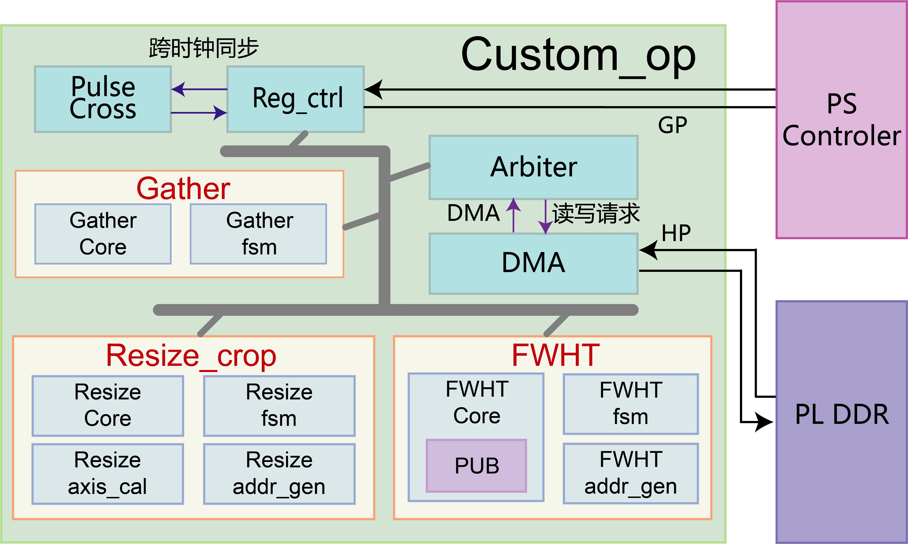
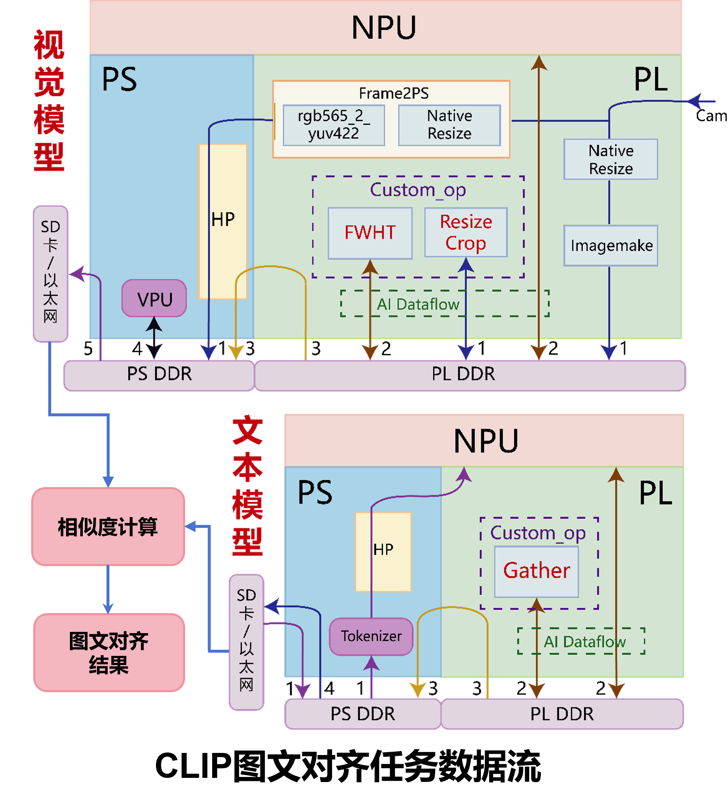

## 快速开始

```bash

python3 deploy/src/gen_board_data.py

# 3. 编译板端程序
cd compile
cmake -S . -B build/ZG -DTARGET_CHIP=ZG
cmake --build build/ZG --target clip_app_web clip_app_split -j4

# 4. 部署到板卡 (结构见第 9 节): 二进制 + configs + board_data + imodel + web_ui

# 5. 启动 Web (板卡上)
cd web_ui && pip install -r requirements.txt
python3 server_onboard.py --host 0.0.0.0 --port 8888   # 推荐: web_app
# 或 python3 server_split.py ...                          # split: 三段切分链路

# 6. 上位机浏览器: http://192.168.137.10:8888 → 模型预热 → 启动推理 → 实时图文对齐
```

> 模型编译（icraft 五阶段）仅在更换模型时需要，见第 5 节。

---

## 1. 背景与开发流程

### 1.1 FPAI 平台简述

FPAI（复旦微 FMQL30TAI / ai7030）单芯片集成三部分：

```
┌─────────────────────────────────────────────┐
│  PS  (Processing System)   通用计算 (ARM CPU) │
│  NPU (诸葛架构)            神经网络推理        │
│  PL  (Programmable Logic)  FPGA 可编程逻辑    │
└─────────────────────────────────────────────┘
```

NPU 原生支持 Conv2d/Linear/LayerNorm/Softmax 等百余种算子；**不支持的算子可通过 PL（FPGA）自定义硬算子扩展**——本项目正是此模式：Hadamard 旋转由自研 FWHT 硬算子（PL）执行。

### 1.2 硬算子整体架构



Custom_op 内部：`reg_ctrl` 接收 CPU 配置（每算子独立控制/地址寄存器），`arbiter` 仲裁三个模块的 DMA 请求（同一时间仅一个访问），`DMA` 负责与 PL DDR 的实际数据传输。

### 1.3 开发流程与数据流意识

FPAI 部署本质是"算法迁移"：把上位机的推理应用（前后处理 + AI 推理）迁移到板卡。**以数据为核心**，明确每个阶段的数据格式、存储位置、计算后端：

```
图像数据流（本项目）:
SDI 相机(RGB565) → ImageMake(PL) → DDR → resize硬算子(PL) → CPU归一化
  → seg_pre(NPU) → LN1 → FWHT硬算子(PL) → rot → seg_post(NPU) → emb(512)
  → cosine(emb, text_feats) → Top-K

文本数据流:
文本 → BPE分词(CPU) → token/pos查表(CPU) → text中间段(NPU) → Gather硬算子(PL)
  → text_proj(CPU) → l2norm → 512-dim 文本特征
```



---

## 2. 开发环境

### 2.1 硬件

| 硬件                               | 说明                                        |
| ---------------------------------- | ------------------------------------------- |
| **FMQL30TAI 开发板**（悟净） | 诸葛架构 NPU；SDI 摄像头 + HDMI 显示        |
| 上位机                             | x86_64 Windows（icraft 编译 + Docker）      |
| 网络                               | 板卡 192.168.137.10 ↔ 上位机 192.168.137.1 |

### 2.2 软件（版本兼容性）

| 软件           | 本项目实测            | 说明                                                                        |
| -------------- | --------------------- | --------------------------------------------------------------------------- |
| icraft SDK     | **3.31 / 3.33** | 本项目 deps 使用 3.33.1 |
| Docker Desktop | 任意                  | 交叉编译容器                                                                |
| CMake          | ≥3.16                | 板端程序构建                                                                |
| aarch64 工具链 | gcc/g++ 9             | 容器内                                                                      |
| Vivado         | 30TAI 支持版本        | FPGA 工程（FPGA/30TAI-PRJ）                                                 |
| Python         | 3.8+                  | 量化/切分/Web                                                               |

### 2.3 SDK 来源（ModelZoo）

- ICraft-ModelZoo（官方模型/示例仓库）：
  https://www.modelscope.cn/models/AIBS/modelzoo_index
- ICraft 教程（toml 配置详解）：
  https://www.modelscope.cn/models/AIBS/icraft_tutorial
- 本项目依赖：SDK 依赖已并入项目 `deploy/deps/`（modelzoo_utils + thirdparty）——**无需单独获取 fpai_demo_app**

---

## 3. 目录结构约定（Windows ↔ Docker）

```
Windows:  D:\icraft-docker\Ubuntu20.04\
Docker:   /mnt/docker_data/          ← 容器内挂载同一内容

Ubuntu20.04/
├── clip-vit-base-patch32-zg/   # ★ 本项目
│   └── deploy/
│       ├── deps/               # ★ SDK 依赖 (已并入项目, 编译必需)
│       │   ├── modelzoo_utils/     # et_device.hpp / icraft_utils.hpp
│       │   └── thirdparty/         # opencv / onnxruntime / yaml-cpp
│       └── src/                # C++ 源文件
└── clip-hhx-new/              # 模型切分工作区（seg 模型源）
```


- `deploy/deps/`（1.2GB：modelzoo_utils + thirdparty）
- `fmodel/vision/`（~800MB：onnx 模型）、`imodel/vision/split/`（240MB：seg 编译产物）
- `test/board_data/`（101MB：板端数据，可运行 `deploy/src/gen_board_data.py` 重新生成）
  克隆项目后无需额外获取 SDK 依赖目录（icraft 工具链仍需使用官方包安装）。

---

## 4. Docker 交叉编译环境

```bash
# 创建容器（镜像 ubuntu20.04:imported）
docker run -dit --name ubuntu20.04_container \
    -v D:\icraft-docker\Ubuntu20.04:/mnt/docker_data \
    ubuntu20.04:imported /bin/bash

# 启动/进入
docker start ubuntu20.04_container
docker exec -it ubuntu20.04_container bash
```

容器内需已安装：aarch64 交叉编译器（/usr/bin/aarch64-linux-gnu-g++）、icraft 运行库（/usr/lib/aarch64-linux-gnu/libicraft_zg330backend.so 等）、SDK 头文件（/usr/include/icraft-*）。

> 缺少时用官方 deb 安装：`dpkg -i Icraft_3.33.1_amd64.deb icraftmdzthirdparty_0.1.1_arm64.deb ...`

---

## 5. icraft 编译链与多阶段产物

### 5.1 编译命令（一条命令全流程）

```bash
# 模型编译配置见 quant_optimize/split/*.toml
cd quant_optimize/split
icraft compile -c compile_vit_seg_pre.toml
# ↑ 自动依次执行: parse → optimize → quantize → adapt → generate
# 产物: imodel/vit_seg_pre/ 下 parsed/optimized/quantized/adapted/ZG 各阶段 JSON&RAW
#       板卡运行用 ZG 阶段 (vit_seg_pre_ZG.{json,raw})
```

### 5.2 编译的五个阶段

`icraft compile` 一条命令依次执行五个阶段：

| 阶段                            | 任务                                                                               | 产物阶段           |
| ------------------------------- | ---------------------------------------------------------------------------------- | ------------------ |
| ①**解析** (parse)        | 读取 ONNX 模型，识别网络算子，解析输入输出定义，转换为 Icraft 中间表示             | parsed             |
| ②**优化** (optimize)     | 图级优化：算子融合、常量折叠、冗余算子消除（DemergeTranspose/ExpandInput 等 Pass） | optimized          |
| ③**量化** (quantize)     | FP32 模型 → 低精度模型（INT8/bf16），适配 NPU 硬件加速能力并降低内存占用          | quantized          |
| ④**适配** (adapt)        | 映射目标硬件后端：算子硬件实现映射、内存布局调整、硬件特定算子逻辑                 | adapted            |
| ⑤**指令生成** (generate) | 生成 NPU 可执行二进制指令文件（JSON&RAW），可在板端 Runtime 加载执行               | BY/**ZG**/WL |

### 5.3 多阶段 JSON&RAW 概念（重要）

```
onnx → parsed → optimized → quantized → adapted → BY/ZG/WL（芯片可运行）
        └────── FP32 无精度损失 ──────┘   └── 量化后存在精度损失 ──┘
```

| 阶段                  | 精度           | 用途                                   |
| --------------------- | -------------- | -------------------------------------- |
| parsed / optimized    | FP32，无损失   | 上位机仿真验证（前后处理对齐）         |
| quantized / adapted   | 量化后，有损失 | 精度评估                               |
| **ZG**（30TAI） | 芯片实际精度   | **板卡运行**（本项目用 ZG 阶段） |

> 本项目板端只用 ZG 阶段产物（vit_seg_pre_ZG / vit_seg_post_ZG / text_middle_ZG）。
> 若仿真/板上结果异常，按阶段回溯：parsed 错 = 解析/前后处理问题；ZG 错 = 量化/硬件问题。

【图片 2：icraft 编译阶段流程图】——建议：onnx → parsed → optimized → quantized → adapted → ZG 的管道图（标注每个阶段的精度状态和用途）。

### 5.4 部署模式说明

| 模式               | 说明                                             | 本项目                               |
| ------------------ | ------------------------------------------------ | ------------------------------------ |
| WIN 仿真           | 上位机直接运行 JSON&RAW（host 后端）             | 未使用（可参考 icraft-utils）        |
| Socket / PSIN      | icraft-serve 远程执行                            | 未使用                               |
| **AXI 直连** | `axi://zg330aiu?npu=0x40000000&dma=0x80000000` | ✅ 本项目（configs/ 的 device 字段） |

---

## 6. 板端程序编译

```bash
cd clip-vit-base-patch32-zg/compile
cmake -S . -B build/ZG -DTARGET_CHIP=ZG
cmake --build build/ZG --target clip_app_split -j4
# 产物: build/ZG/clip_app_split
# 这里可以不加--target和--j4选项，此时会编译全部C++和测试文件
```

**源文件单一来源**：`deploy/src/`（CMake 自动引用），新增程序在 CMakeLists `TARGET_NAMES` 注册。

---

## 7. FPGA 工具链（可选）

```bash
#Vivado 打开 FPGA/30TAI-PRJ
#综合/实现 → bitstream → Procise生成BOOT.bin
#板上运行下面代码
mount /dev/mmcblk0p1 /root/bits
cd /root/bit
reboot #重启后bit流生效
```

---

## 8. 编译验证（冒烟测试）

```bash
# 1. 板端程序 --在docker端完成编译
cd compile && cmake --build build/ZG --target clip_app_split -j4

# 2. 模型编译（需 models/ 齐全）--host端
cd quant_optimize/split && icraft compile -c compile_vit_seg_pre.toml

# 3. Web 服务 --开发板端
cd web_ui
pip install -r requirements.txt   # Web 服务依赖 (web_ui/requirements.txt)
python server_split.py
```

---

## 9. 板卡部署

```
/root/fpai_demo_app/examples/visual/
├── clip_app_split
├── configs/app_config_split.yaml
├── imodel/ZG/                # text_middle_ZG.{json,raw}
├── board_data/
└── web_ui/

/root/fpai_demo_app/examples/split/
├── vit_seg_pre_ZG.{json,raw}
└── vit_seg_post_ZG.{json,raw}
```

**board_data 数据获取**（token_emb/pos_emb/text_proj/merges——项目内一条命令生成）：

```bash
# 上位机 (项目根目录)
python3 deploy/src/gen_board_data.py
# → test/board_data/ 生成 4 个文件, 连同 labels.txt 一起拷贝到板卡 data_dir
```

启动：

```bash
cd web_ui && python3 server_split.py
# 上位机浏览器: http://192.168.137.10:8888
```

---

### 9.x 运行状态与重置机制

**性能**：
- 实时展示：**~20 FPS**
- 图像编码器：无硬算子 **86.9ms** → 本方案 **47.3ms**（加速 83.7%）
- 文本编码器：无硬算子 **54.8ms** → 本方案 **42.6ms**（加速 28.6%）
- 双路总推理：无硬算子 **141.7ms** → 本方案 **89.9ms**（加速 57.6%）

**稳定性**：

- **标签规模较大**时若出现 seg_pre 任务延迟，通过**程序状态重置**恢复
- **程序状态重置机制**（自动，无需人工干预）：
  1. NPU 任务超时（2s）→ 打印 `[FATAL]` → **程序自重启**（exec，全新状态）
  2. 重启前保存状态到 `board_data/`（label_cache.txt / label_feats_cache.bin / state_cache.txt）
  3. 重启后自动恢复标签 + 帧数 + 直接进入 dual mode——**十几秒内恢复正常工作**
- 周期排空（每 100 次编码 20ms）+ FWHT 超时重试 + 预分配复用（零堆碎片）

**观察日志**：

- `[FATAL] xxx not ready, 程序重启` → 自愈触发
- `[SAVE] 状态已保存: N 标签` → 重启前快照
- `[RESTORE] 从缓存恢复 N 标签` → 重启后恢复
- `[TEXT] full_ms=... (lookup=... npu=... gather=... proj=...)` → 文本编码全流程分段耗时（应稳定在 ~42.6ms 附近）
- `[IMG] total_ms=... (resize=... norm=... pre=... fwht=... post=...)` → 图像编码分段耗时（性能测试接口）

---

## 10. 常见问题

| 现象                  | 原因             | 解决                                                                                                |
| --------------------- | ---------------- | --------------------------------------------------------------------------------------------------- |
| cmake 报 deps 找不到  | deploy/deps 缺失 | 检查`deploy/deps/modelzoo_utils` 是否存在（已并入项目）                                           |
| 容器无 aarch64 工具链 | 未装             | `apt install g++-aarch64-linux-gnu`                                                               |
| icraft 命令不存在     | SDK 未装         | dpkg 安装 Icraft deb                                                                                |
| seg 模型 _ZG 缺失     | 未编译           | 详见第5节编译链                                                                                     |
| 板卡 add 后卡死       | 三会话冲突       | 使用当前实现（text 线程+锁+排空）一般没问题，若出现错误可以使用clip_app_web实现同等功能（优化较弱） |
| FWHT 输出垃圾         | 字节序错误       | 代码用**小端**布局（`buf[j*2]=lo`）                                                         |
| 板上精度异常          | 阶段/量化问题    | 按 5.2 阶段回溯定位                                                                                 |
